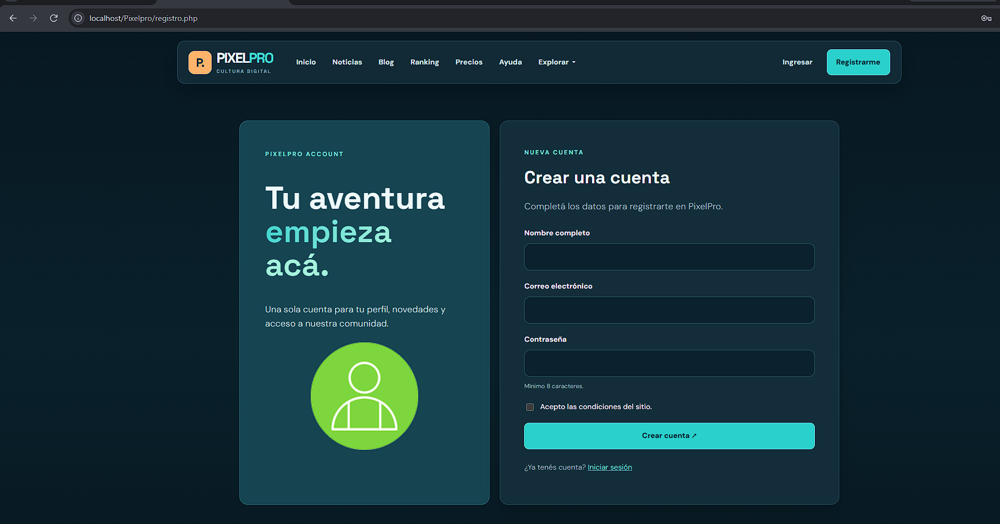
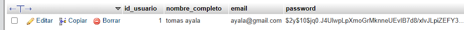
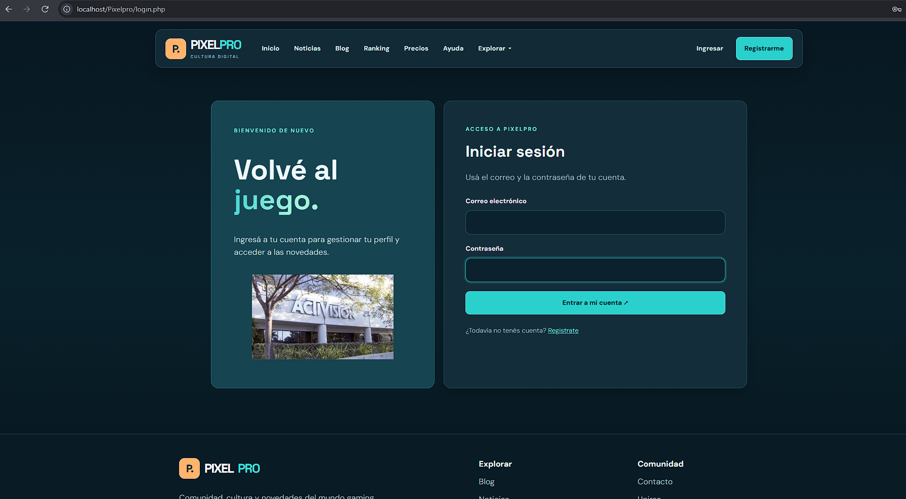
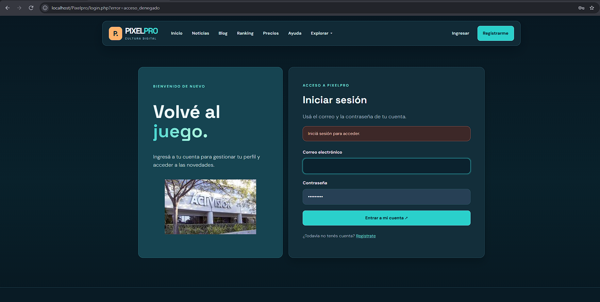
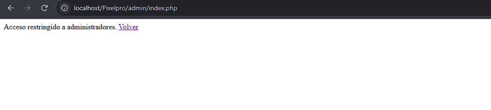
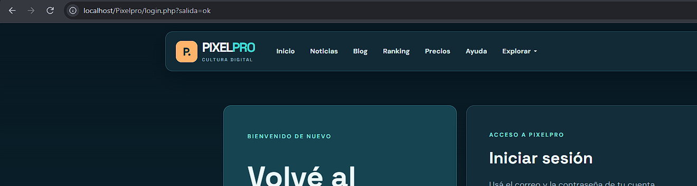

# PixelPro — TP8

**Proyecto:** Portal gamer PixelPro · Integrador de Programación Web TP4–TP8.

**Instalación previa:** colocar `PixelPro/` en `C:\xampp\htdocs\`, encender Apache y MySQL, importar `PixelPro/database/schema.sql` en phpMyAdmin y configurar `PixelPro/config/.env` a partir de `.env.example` sin compartir las credenciales. Abrir `http://localhost/PixelPro/`.

## Objetivo

Agregar autenticación de usuarios, contraseñas protegidas, sesiones y autorización por roles.

## Implementación

- `registro.php`: crea cuentas en `usuarios`, guardando `password_hash($pass, PASSWORD_DEFAULT)`.
- `login.php`: verifica credenciales con `password_verify()` y ejecuta `session_regenerate_id(true)`.
- `includes/funciones.php`: maneja `$_SESSION['usuario']`, cookies de sesión (`HttpOnly`, `SameSite=Lax`) y verificaciones.
- `includes/auth_guard.php`: protección del panel personal.
- `admin/verificar_admin.php`: restringe las páginas de administración a rol `admin`.
- `panel.php`: muestra la cuenta autenticada.
- `logout.php`: cierra sesión con POST, CSRF y `session_destroy()`.

### 1. Registro de usuarios

Formulario que permite crear una nueva cuenta en PixelPro.

### 2. Contraseñas protegidas

Visualización de las contraseñas almacenadas mediante hash en la base de datos.

### 3. Inicio de sesión

Formulario de acceso al sistema utilizando las credenciales registradas.

### 4. Sesión iniciada

Panel personal que aparece cuando el usuario inicia sesión correctamente.

### 5. Roles y permisos

Comprobación del control de acceso según el rol asignado al usuario.

### 6. Cierre de sesión

Comprobación del cierre de sesión del usuario.

